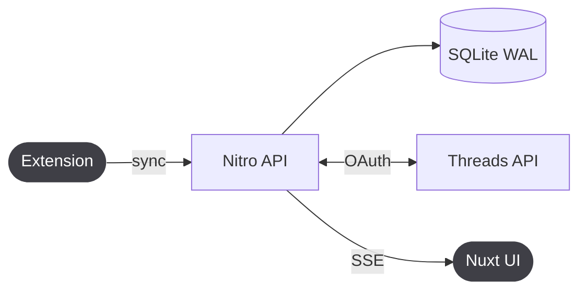
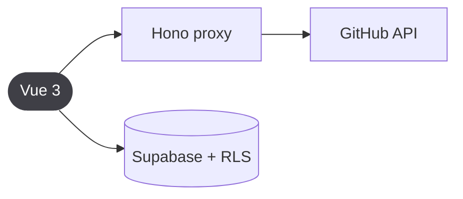
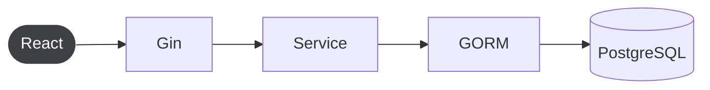
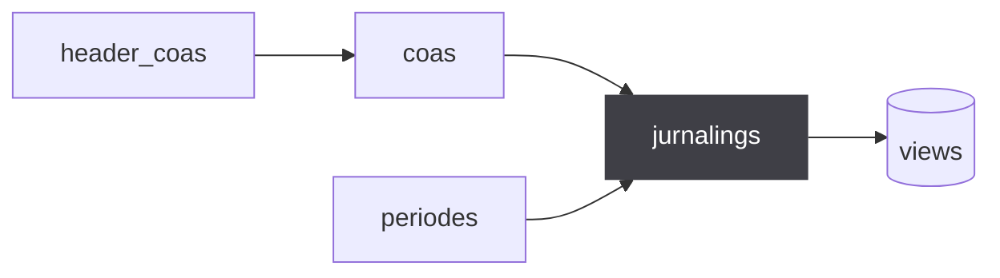
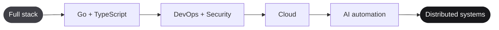

**[🚀 Projects](#-projects) · [💼 Experience](#-experience) · [🧰 Stack](#-stack) · [📊 Stats](#-stats) · [🧪 Learning](#-learning-next)**

<b>👋 Pick your path</b>

 

| If you are | Start here |
|---|---|
| 🎯 **Hiring** | [Experience](#-experience) · [LinkedIn](https://www.linkedin.com/in/kevin-van-diesel-chansa/) |
| 🔍 **Reviewing code** | [SijiSiyu](https://github.com/yesterdaygrace/SijiSiyu) · [Inventra](https://github.com/yesterdaygrace/Inventra) (each has a `docs/` folder) |
| ⚡ **Short on time** | [DevScout live demo](https://dev-scout-lac.vercel.app) · [Portfolio](https://yesterdaygrace.github.io/portfolio/) |

| | |
|---|---|
| 💼 **Now** | Junior Software Engineer at **PT Sahabat Unggul International**: factory web and desktop apps, MySQL/MariaDB, Linux, Docker, Apache |
| 🎓 **Education** | Informatics Engineering, Universitas Kristen Satya Wacana |
| 🛠️ **Experience** | 2+ years shipping and maintaining business software |
| 🧭 **Next** | Go and TypeScript beyond my Laravel base, then DevOps, security and AI automation |

---

## 🚀 Projects

<table>
<tr>
<td width="50%" valign="top">

**🧵 [SijiSiyu](https://github.com/yesterdaygrace/SijiSiyu)** 
Local-first Threads library with a Chromium extension that scans and syncs your saved posts.  
 

</td>
<td width="50%" valign="top">

**🔎 [DevScout](https://github.com/yesterdaygrace/DevScout)** · [live](https://dev-scout-lac.vercel.app) 
Search, compare and score GitHub developers. Collections, notes, per-user RLS.  
 

</td>
</tr>
<tr>
<td width="50%" valign="top">

**📦 [Inventra](https://github.com/yesterdaygrace/Inventra)** 
Multi-warehouse inventory: append-only ledger, reservations, idempotent stock operations.  
 

</td>
<td width="50%" valign="top">

**🏦 [DAPENSE](https://github.com/yesterdaygrace/DAPENSE)** 
Pension fund accounting: double-entry journals, period close, role-gated reports.  
 

</td>
</tr>
</table>

<b>🧵 SijiSiyu: how the scanner works</b>

 

- 📥 Saving a post on `threads.net` streams it to the local app and shows a toast
- 🔄 `MutationObserver` captures new bookmarks as the `/saved` feed scrolls; a bulk scan walks the full history
- 📴 Offline queue in `chrome.storage.local` flushes when the backend returns
- 🧩 Why an extension: Meta's Threads API has no Saved or Unsave endpoint, so the project reads the logged-in site instead
- 🔐 Tokens are AES-256-GCM encrypted at rest; sessions store only a SHA-256 hash; OAuth state guards against login CSRF

<b>🔎 DevScout: how it's built</b>

 

- 🔑 The GitHub token stays server-side behind a Zod-validated Hono proxy with rate limiting and a request queue
- 🧮 6-factor candidate score (0 to 100) and a language breakdown over up to 20 non-fork repos
- 🛡️ Row Level Security on all 7 tables; Vitest unit tests and Playwright E2E

<b>📦 Inventra: how it protects stock</b>

 

- 📒 Append-only ledger: corrections add a row, balances are derived on read
- 🔒 `SELECT ... FOR UPDATE` row locks inside transactions; idempotency keys return `409` on a changed body
- 🪪 JWT with refresh rotation and reuse detection, DB-backed RBAC, failure-safe audit trail
- ✅ 17 tables, 13 migrations, CI coverage gate at 80% per package

<b>🏦 DAPENSE: how it keeps books</b>

 

- 🗄️ 3NF schema, 8 core tables, `NUMERIC(15,2)` money columns and a balanced-journal guard
- 📅 Open, closed, then trial-balance snapshot per period
- 🛡️ 4 roles enforced by Policies and Gates; encrypted backups with 30-day retention

**More repositories**

| Repo | What it is | Stack |
|---|---|---|
| 🎬 [CinemaSystem](https://github.com/yesterdaygrace/CinemaSystem) | Cinema ticketing backend assessment. PostgreSQL `btree_gist` blocks overlapping schedules. Its Redis seat lock is a design proposal only. |  |
| 📝 [Nodex](https://github.com/yesterdaygrace/Nodex) | CRUD API with pagination and a test suite that locks the API contract |  |
| 🌐 [portfolio](https://github.com/yesterdaygrace/portfolio) | Case-study portfolio, CI audit, typecheck and build, deployed to GitHub Pages |  |

---

## 💼 Experience

| When | Role |
|---|---|
| `Oct 2026 → now` | 🏭 **Junior Software Engineer**, PT Sahabat Unggul International (contract) |
| `Aug 2024 → Dec 2025` | 🏦 **Full Stack Web Developer (intern)**, Dana Pensiun Sekolah Kristen Salatiga |
| `Aug → Dec 2024` | 🎓 **Teaching Assistant**, Web Developer course, UKSW |

<b>🏭 Sahabat Unggul: factory systems</b>

 

- 🐞 Fix bugs and add features to SUI APPS V2.0 (web and desktop) from factory operations requirements
- 🗄️ Run MySQL/MariaDB: backups, query tuning, monitoring
- 🐧 Support Linux servers: Docker containers, Apache and MySQL services, log monitoring
- 🤝 Gather requirements with HR, Production, Finance and Warehouse; document code changes and procedures

<b>🏦 Dana Pensiun: legacy VDOS to Laravel</b>

 

- 🔁 Migrated a legacy VDOS-based financial system to Laravel
- 📚 Built General Ledger, Journal Processing, Cash & Bank, Financial Reporting and Balance Reconciliation modules
- 🧾 Turned accounting workflows into features with finance stakeholders, in 1 to 2 week sprints
- ✅ Tested at unit, integration and UAT level before releases
- 📈 Self-reported results: about 30 to 40% better operational efficiency and 25 to 30% fewer manual input errors

<b>🎓 Teaching assistant</b>

 

4 classes, 100+ students, 400+ assignments reviewed. Taught HTML, CSS, PHP and MySQL, and standardized grading across classes.

---

## 🧰 Stack

<table>
<tr><td align="right"><b>Languages</b></td><td></td></tr>
<tr><td align="right"><b>Frameworks</b></td><td></td></tr>
<tr><td align="right"><b>Data</b></td><td></td></tr>
<tr><td align="right"><b>Infra</b></td><td></td></tr>
<tr><td align="right"><b>CI/CD</b></td><td> </td></tr>
<tr><td align="right"><b>Quality &amp; security</b></td><td>  </td></tr>
<tr><td align="right"><b>Tools</b></td><td>  </td></tr>
</table>

<b>🔎 Full breakdown</b>

 

| Layer | Tools |
|---|---|
| ⚙️ **Backend** | Laravel, Livewire, Go (Gin, GORM), Nuxt/Nitro, Hono, Zod, REST, OpenAPI, JWT, OAuth 2.0, SSE |
| 🎨 **Frontend** | React 19, Vue 3, Nuxt, Pinia, TanStack Query, Tailwind, Vite, TypeScript, Chart.js |
| 🗄️ **Data** | PostgreSQL, MySQL/MariaDB, SQLite (WAL), Redis, Supabase, ERD design, indexing, query tuning |
| 🐳 **Infra** | Linux, Docker, Docker Compose, Nginx, Apache, systemd, Vercel, Kubernetes (learning) |
| 🔁 **CI/CD** | GitHub Actions (build, test, lint, audit, deploy), Vercel, GitHub Pages |
| 🛡️ **Security & quality** | OWASP, Semgrep, SonarQube, govulncheck, AES-256-GCM, JWT rotation, bcrypt, RBAC, RLS, rate limiting |
| 🧪 **Testing & debugging** | testify, uber mock, Vitest, PHPUnit, Playwright, Postman, Chrome DevTools |
| 🧰 **Workflow** | Jira, Git, Docker-based local environments |
| 🌐 **Browser** | Chromium extensions, content scripts, MutationObserver |
| 🤖 **AI tools** | Claude, Cursor, Codex, ChatGPT, OpenCode |

---

## 📊 Stats

<picture>
  <source media="(prefers-color-scheme: dark)" srcset="https://github-readme-stats.vercel.app/api?username=yesterdaygrace&show_icons=true&hide_border=true&count_private=true&include_all_commits=true&theme=dark&bg_color=0d1117&title_color=ffffff&icon_color=a1a1aa" />
  
</picture>
<picture>
  <source media="(prefers-color-scheme: dark)" srcset="https://github-readme-stats.vercel.app/api/top-langs/?username=yesterdaygrace&layout=compact&hide_border=true&langs_count=8&theme=dark&bg_color=0d1117&title_color=ffffff" />
  
</picture>

<picture>
  <source media="(prefers-color-scheme: dark)" srcset="https://streak-stats.demolab.com?user=yesterdaygrace&hide_border=true&theme=dark&background=0d1117&ring=ffffff&fire=a1a1aa&currStreakLabel=ffffff" />
  
</picture>

<b>📈 Contribution graph</b>

 

<picture>
  <source media="(prefers-color-scheme: dark)" srcset="https://github-readme-activity-graph.vercel.app/graph?username=yesterdaygrace&bg_color=0d1117&color=ffffff&line=a1a1aa&point=ffffff&area=true&area_color=3f3f46&hide_border=true" />
  
</picture>

---

## 🧪 Learning next

  

