

   
  <a href="https://www.linkedin.com/in/kevin-van-diesel-chansa/">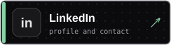</a>
  
  <a href="https://dev-scout-lac.vercel.app">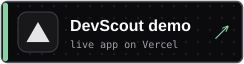</a>
   
  
  <a href="#experience">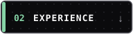</a>
  <a href="#stack">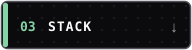</a>
  
  <a href="#learning">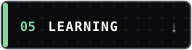</a>

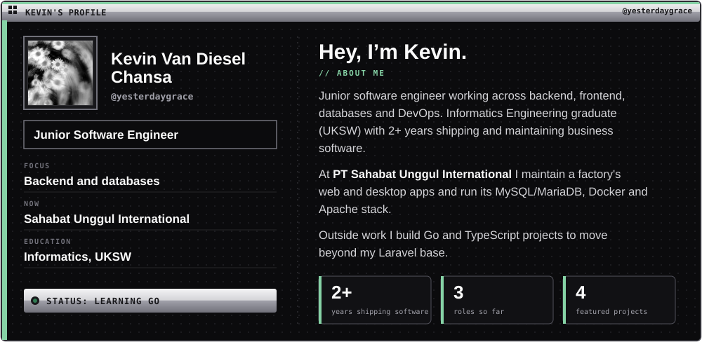

  
  <a href="#projects">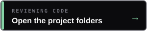</a>
  <a href="https://dev-scout-lac.vercel.app">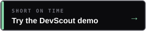</a>

  
  
  
  

Click a folder to jump to its details below.

  
  
  

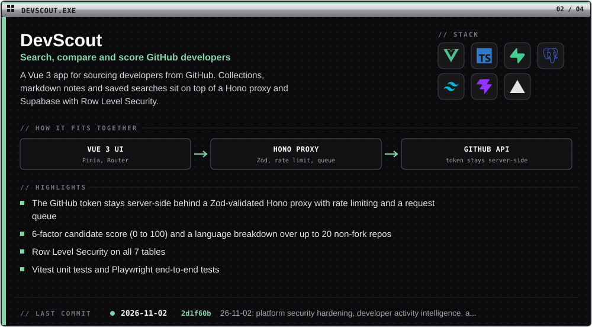

  
  
  
  

  
  
  

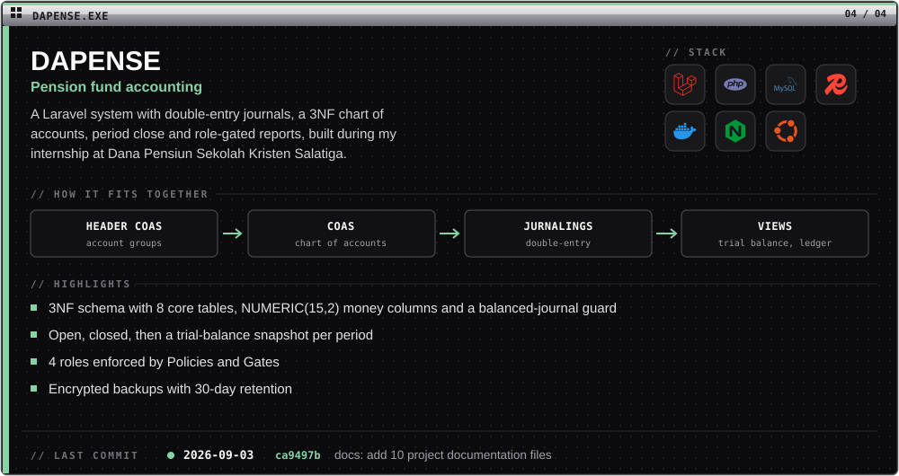

  
  
  

**More repositories**

| Repo | What it is | Stack |
|---|---|---|
| 🎬 [CinemaSystem](https://github.com/yesterdaygrace/CinemaSystem) | Cinema ticketing backend assessment. PostgreSQL `btree_gist` blocks overlapping schedules. Its Redis seat lock is a design proposal only. |  |
| 📝 [Nodex](https://github.com/yesterdaygrace/Nodex) | CRUD API with pagination and a test suite that locks the API contract |  |
| 🌐 [portfolio](https://github.com/yesterdaygrace/portfolio) | Case-study portfolio; CI runs audit, typecheck and build, then deploys to GitHub Pages |  |

<a href="#e-sahabat">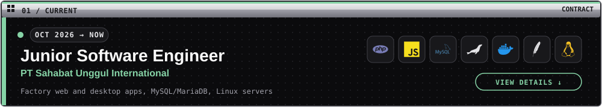</a>

<a href="#e-dana">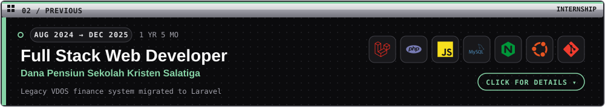</a>

<a href="#e-ta">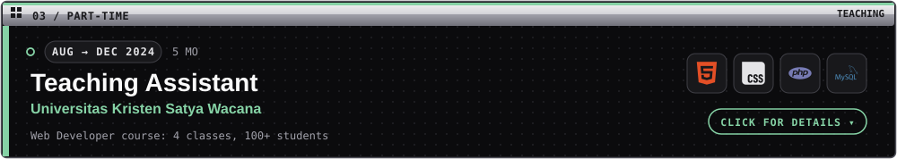</a>

Click a role to jump to its full description below.

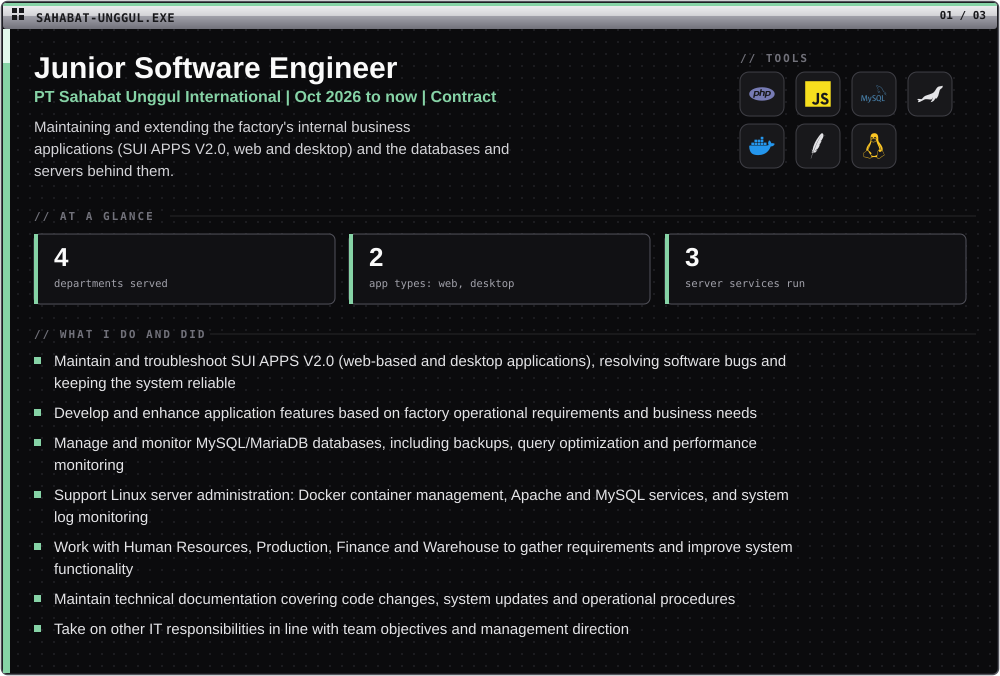

  

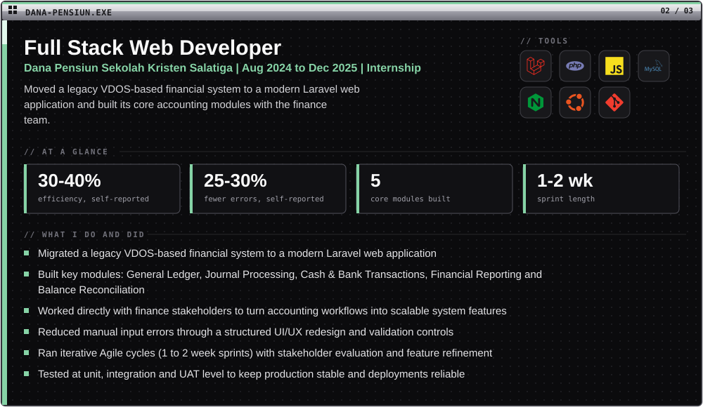

  

  

<b>🔎 Full breakdown</b>

 

| Layer | Tools |
|---|---|
| ⚙️ **Backend** | Laravel, Livewire, Go (Gin, GORM), Nuxt/Nitro, Hono, Zod, REST, OpenAPI, JWT, OAuth 2.0, SSE |
| 🎨 **Frontend** | React 19, Vue 3, Nuxt, Pinia, TanStack Query, Tailwind, Vite, TypeScript, Chart.js |
| 🗄️ **Data** | PostgreSQL, MySQL/MariaDB, SQLite (WAL), Redis, Supabase, ERD design, indexing, query tuning |
| 🐳 **Infra** | Linux, Docker, Docker Compose, Nginx, Apache, systemd, Vercel, Kubernetes (learning) |
| 🔁 **CI/CD** | GitHub Actions (build, test, lint, audit, deploy), Vercel, GitHub Pages |
| 🛡️ **Security & quality** | OWASP, Semgrep, SonarQube, govulncheck, AES-256-GCM, JWT rotation, bcrypt, RBAC, RLS, rate limiting |
| 🧪 **Testing & debugging** | testify, uber mock, Vitest, PHPUnit, Playwright, Postman, Chrome DevTools |
| 🧰 **Workflow** | Jira, Git, VS Code, Docker-based local environments |
| 🌐 **Browser** | Chromium extensions, content scripts, MutationObserver |
| 🤖 **AI tools** | Claude, Cursor, Codex, ChatGPT, OpenCode |

<picture>
  <source media="(prefers-color-scheme: dark)" srcset="https://github-readme-stats.vercel.app/api?username=yesterdaygrace&show_icons=true&hide_border=true&count_private=true&include_all_commits=true&theme=dark&bg_color=0d1117&title_color=ffffff&icon_color=86d3a6" />
  
</picture>
<picture>
  <source media="(prefers-color-scheme: dark)" srcset="https://github-readme-stats.vercel.app/api/top-langs/?username=yesterdaygrace&layout=compact&hide_border=true&langs_count=8&theme=dark&bg_color=0d1117&title_color=ffffff" />
  
</picture>

<picture>
  <source media="(prefers-color-scheme: dark)" srcset="https://streak-stats.demolab.com?user=yesterdaygrace&hide_border=true&theme=dark&background=0d1117&ring=86d3a6&fire=86d3a6&currStreakLabel=ffffff" />
  
</picture>

<b>📈 Contribution graph</b>

 

<picture>
  <source media="(prefers-color-scheme: dark)" srcset="https://github-readme-activity-graph.vercel.app/graph?username=yesterdaygrace&bg_color=0d1117&color=ffffff&line=86d3a6&point=ffffff&area=true&area_color=3f3f46&hide_border=true" />
  
</picture>

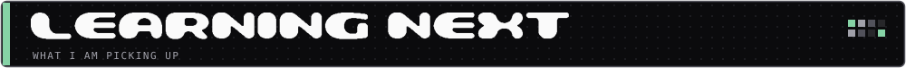

   
   
   
   
  

