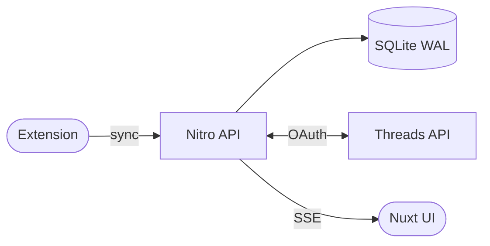
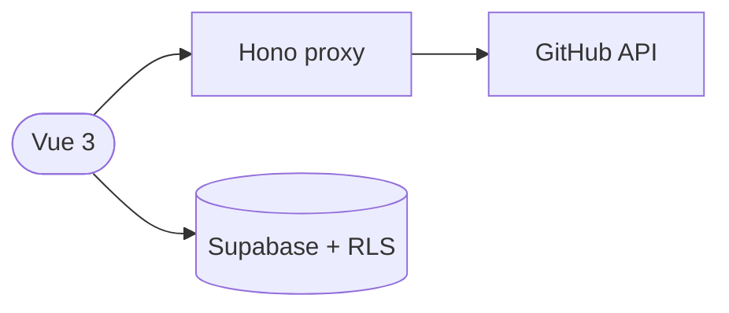
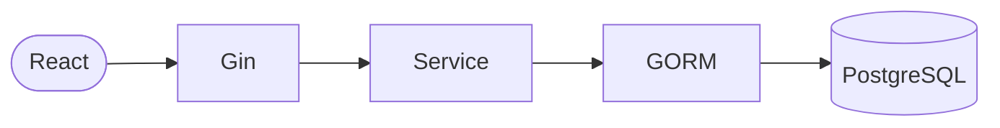
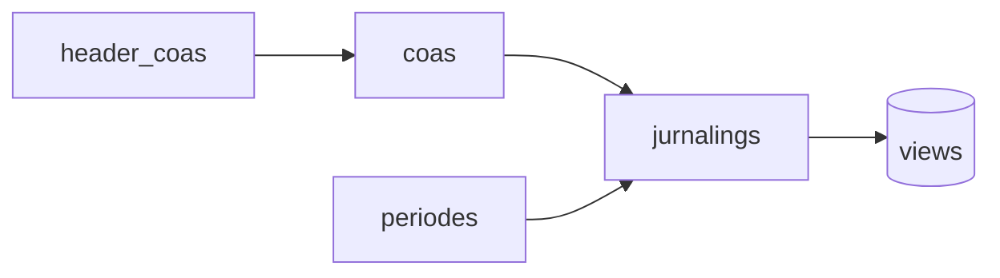
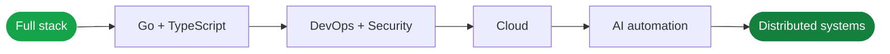

**[Projects](#-projects) · [Experience](#-experience) · [Stack](#-stack) · [Stats](#-stats) · [Learning](#-learning-next)**

<b>👋 Pick your path</b>

 

| If you are | Start here |
|---|---|
| **Hiring** | [Experience](#-experience) · [LinkedIn](https://www.linkedin.com/in/kevin-van-diesel-chansa/) |
| **Reviewing code** | [SijiSiyu](https://github.com/yesterdaygrace/SijiSiyu) · [Inventra](https://github.com/yesterdaygrace/Inventra) (each has a `docs/` folder) |
| **Short on time** | [DevScout live demo](https://dev-scout-lac.vercel.app) · [Portfolio](https://yesterdaygrace.github.io/portfolio/) |

I'm a junior software engineer working across backend, frontend, databases and DevOps. Informatics Engineering graduate (UKSW), 2+ years shipping and maintaining business software. At **PT Sahabat Unggul International** I maintain a factory's web and desktop apps and run its MySQL/MariaDB, Docker and Apache stack. Outside work I build Go and TypeScript projects to move beyond my Laravel base.

---

## 🚀 Projects

<table>
<tr>
<td width="50%" valign="top">

**🧵 [SijiSiyu](https://github.com/yesterdaygrace/SijiSiyu)** 
Local-first Threads library with a Chromium extension that scans and syncs your saved posts. 
`Nuxt` `SQLite` `SSE` `AES-256-GCM` 

</td>
<td width="50%" valign="top">

**🔎 [DevScout](https://github.com/yesterdaygrace/DevScout)** · [live](https://dev-scout-lac.vercel.app) 
Search, compare and score GitHub developers. Collections, notes, per-user RLS. 
`Vue 3` `Hono` `Supabase` `Vercel` 

</td>
</tr>
<tr>
<td width="50%" valign="top">

**📦 [Inventra](https://github.com/yesterdaygrace/Inventra)** 
Multi-warehouse inventory: append-only ledger, reservations, idempotent stock operations. 
`Go` `PostgreSQL 17` `React 19` `Docker` 

</td>
<td width="50%" valign="top">

**🏦 [DAPENSE](https://github.com/yesterdaygrace/DAPENSE)** 
Pension fund accounting: double-entry journals, period close, role-gated reports. 
`Laravel` `PHP 8.3` `MySQL 8.4` `Redis` 

</td>
</tr>
</table>

<b>🧵 SijiSiyu: how the scanner works</b>

 

- Saving a post on `threads.net` streams it to the local app and shows a toast
- `MutationObserver` captures new bookmarks as the `/saved` feed scrolls; a bulk scan walks the full history
- Offline queue in `chrome.storage.local` flushes when the backend returns
- Why an extension: Meta's Threads API has no Saved or Unsave endpoint, so the project reads the logged-in site instead
- Tokens are AES-256-GCM encrypted at rest; sessions store only a SHA-256 hash; OAuth state guards against login CSRF

<b>🔎 DevScout: how it's built</b>

 

- The GitHub token stays server-side behind a Zod-validated Hono proxy with rate limiting and a request queue
- 6-factor candidate score (0 to 100) and a language breakdown over up to 20 non-fork repos
- Row Level Security on all 7 tables; Vitest unit tests and Playwright E2E

<b>📦 Inventra: how it protects stock</b>

 

- Append-only ledger: corrections add a row, balances are derived on read
- `SELECT ... FOR UPDATE` row locks inside transactions; idempotency keys return `409` on a changed body
- JWT with refresh rotation and reuse detection, DB-backed RBAC, failure-safe audit trail
- 17 tables, 13 migrations, CI coverage gate at 80% per package

<b>🏦 DAPENSE: how it keeps books</b>

 

- 3NF schema, 8 core tables, `NUMERIC(15,2)` money columns and a balanced-journal guard
- Open, closed, then trial-balance snapshot per period
- 4 roles enforced by Policies and Gates; encrypted backups with 30-day retention

**More:** [CinemaSystem](https://github.com/yesterdaygrace/CinemaSystem) (Go, PostgreSQL `btree_gist` schedule-overlap guard; its Redis seat lock is a design proposal only) · [Nodex](https://github.com/yesterdaygrace/Nodex) (Go + Gin CRUD API with a contract-locking test suite) · [portfolio](https://github.com/yesterdaygrace/portfolio) (React 19, GitHub Pages CI)

---

## 💼 Experience

| When | Role |
|---|---|
| `Oct 2026 → now` | **Junior Software Engineer**, PT Sahabat Unggul International (contract) |
| `Aug 2024 → Dec 2025` | **Full Stack Web Developer (intern)**, Dana Pensiun Sekolah Kristen Salatiga |
| `Aug → Dec 2024` | **Teaching Assistant**, Web Developer course, UKSW |

<b>🏭 Sahabat Unggul: factory systems</b>

 

- Fix bugs and add features to SUI APPS V2.0 (web and desktop) from factory operations requirements
- Run MySQL/MariaDB: backups, query tuning, monitoring
- Support Linux servers: Docker containers, Apache and MySQL services, log monitoring
- Gather requirements with HR, Production, Finance and Warehouse; document code changes and procedures

`PHP` `JavaScript` `MySQL/MariaDB` `Docker` `Apache` `Linux`

<b>🏦 Dana Pensiun: legacy VDOS to Laravel</b>

 

- Migrated a legacy VDOS-based financial system to Laravel
- Built General Ledger, Journal Processing, Cash & Bank, Financial Reporting and Balance Reconciliation modules
- Turned accounting workflows into features with finance stakeholders; 1 to 2 week sprints
- Tested at unit, integration and UAT level before releases
- Self-reported results: about 30 to 40% better operational efficiency and 25 to 30% fewer manual input errors

<b>🎓 Teaching assistant</b>

 

4 classes, 100+ students, 400+ assignments reviewed. Taught HTML, CSS, PHP and MySQL, and standardized grading across classes.

---

## 🛠️ Stack

<b>Full breakdown</b>

 

| Layer | Tools |
|---|---|
| **Backend** | Laravel, Livewire, Go (Gin, GORM), Nuxt/Nitro, Hono, Zod, REST, OpenAPI, JWT, OAuth 2.0, SSE |
| **Frontend** | React 19, Vue 3, Nuxt, Pinia, TanStack Query, Tailwind, Vite, TypeScript, Chart.js |
| **Data** | PostgreSQL, MySQL/MariaDB, SQLite (WAL), Redis, Supabase, ERD design, indexing, query tuning |
| **Infra** | Linux, Docker Compose, Nginx, Apache, GitHub Actions, Vercel, systemd |
| **Security** | AES-256-GCM, JWT rotation, bcrypt, RBAC, RLS, rate limiting, govulncheck |
| **Testing** | testify, uber mock, Vitest, PHPUnit, Playwright, Postman |
| **Browser** | Chromium extensions, content scripts, MutationObserver |
| **AI tools** | Claude, Cursor, Codex, ChatGPT, OpenCode |

---

## 📊 Stats

<picture>
  <source media="(prefers-color-scheme: dark)" srcset="https://github-readme-stats.vercel.app/api?username=yesterdaygrace&show_icons=true&hide_border=true&count_private=true&include_all_commits=true&theme=tokyonight&bg_color=0d1117&title_color=4ade80&icon_color=16a34a" />
  
</picture>
<picture>
  <source media="(prefers-color-scheme: dark)" srcset="https://github-readme-stats.vercel.app/api/top-langs/?username=yesterdaygrace&layout=compact&hide_border=true&langs_count=8&theme=tokyonight&bg_color=0d1117&title_color=4ade80" />
  
</picture>

<picture>
  <source media="(prefers-color-scheme: dark)" srcset="https://streak-stats.demolab.com?user=yesterdaygrace&hide_border=true&theme=tokyonight&background=0d1117&ring=4ade80&fire=16a34a&currStreakLabel=4ade80" />
  
</picture>

<b>Contribution graph</b>

 

<picture>
  <source media="(prefers-color-scheme: dark)" srcset="https://github-readme-activity-graph.vercel.app/graph?username=yesterdaygrace&bg_color=0d1117&color=4ade80&line=16a34a&point=ffffff&area=true&area_color=16a34a&hide_border=true" />
  
</picture>

---

## 🧪 Learning next

