

   
  
  <a href="https://yesterdaygrace.github.io/portfolio/">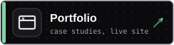</a>
  
  <a href="https://github.com/yesterdaygrace?tab=repositories">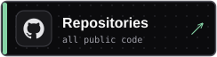</a> 
  <a href="#projects">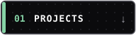</a>
  
  
  <a href="#stats">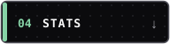</a>
  

  <a href="#experience">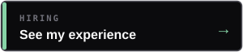</a>
  
  

  
  <a href="#p-devscout">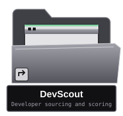</a>
  
  

Click a folder to jump to its details below.

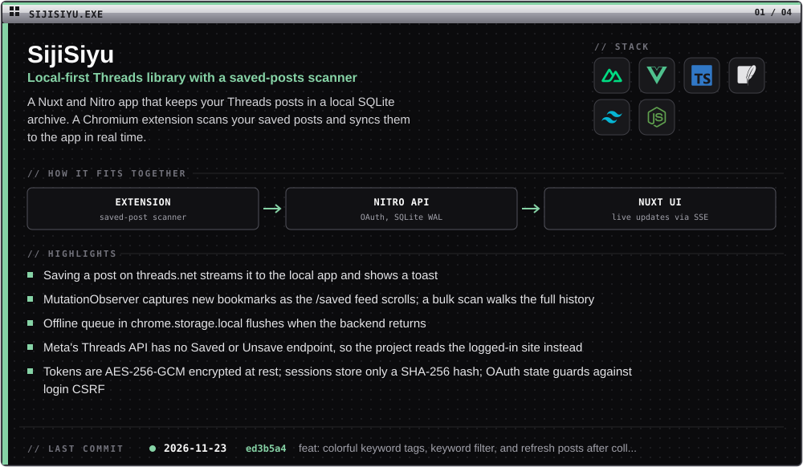

  

  
  <a href="https://dev-scout-lac.vercel.app">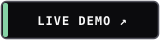</a>

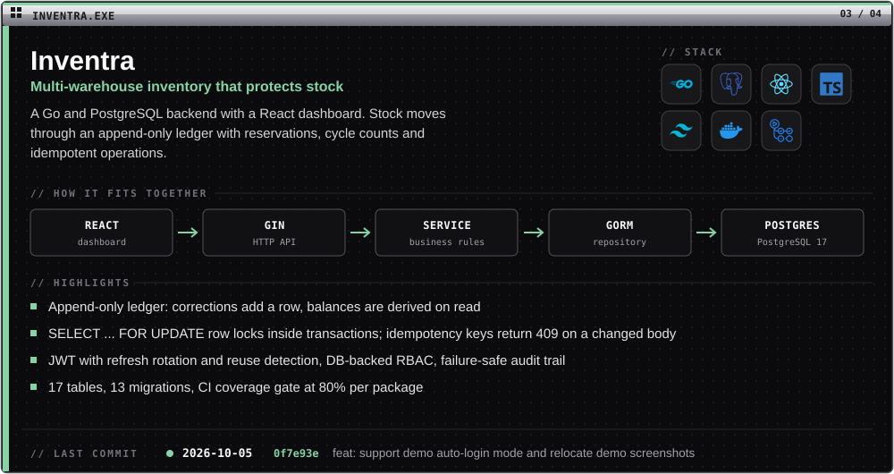

  

  

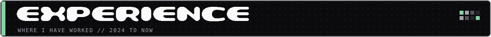

Click a role to jump to its full description below.

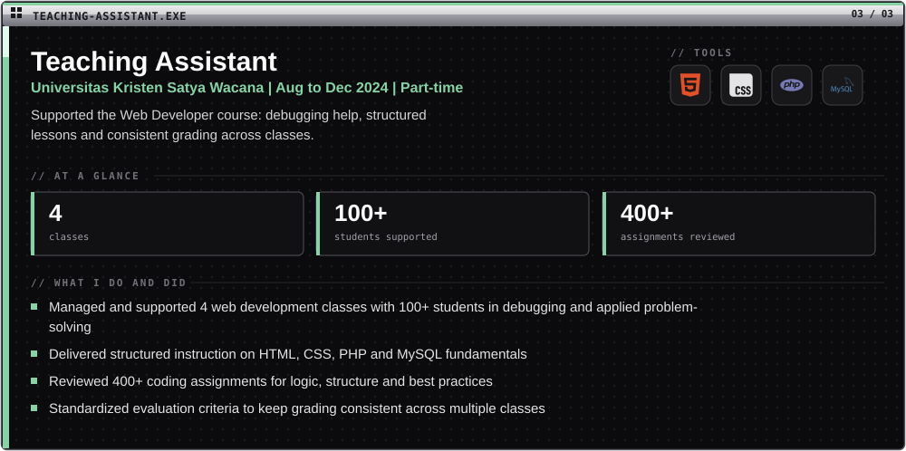

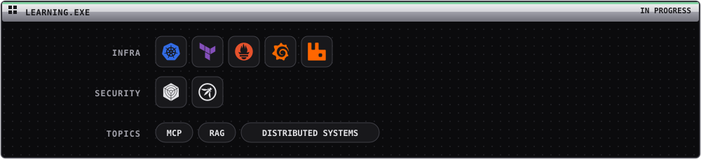

  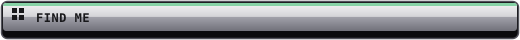 
   
   
   
  

