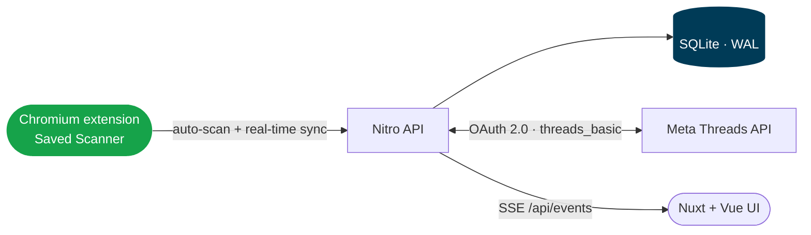
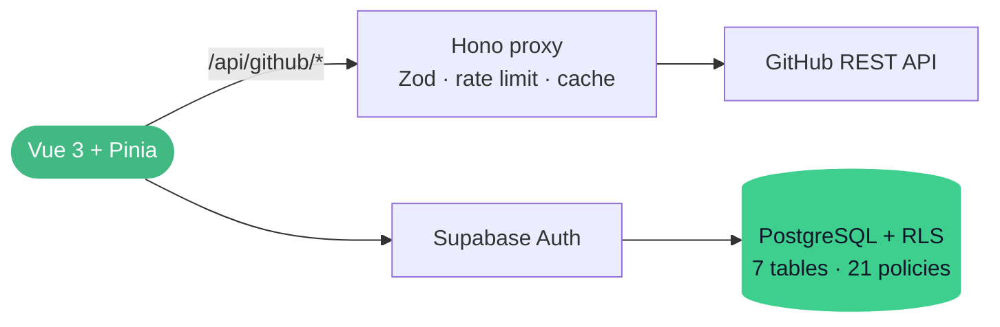
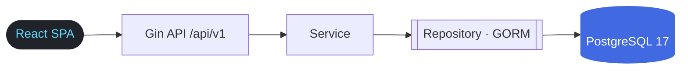
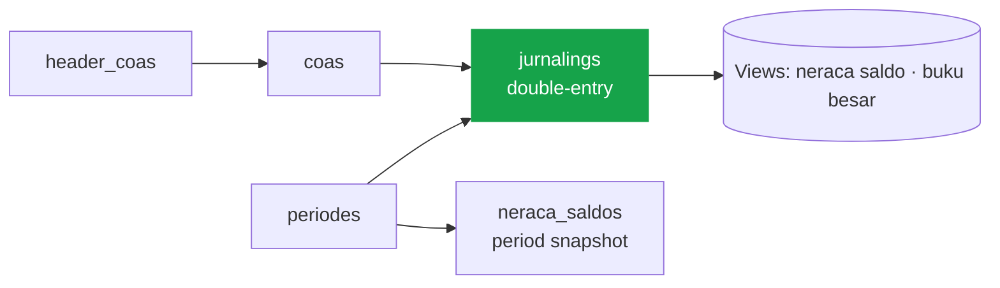
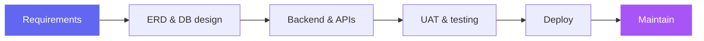
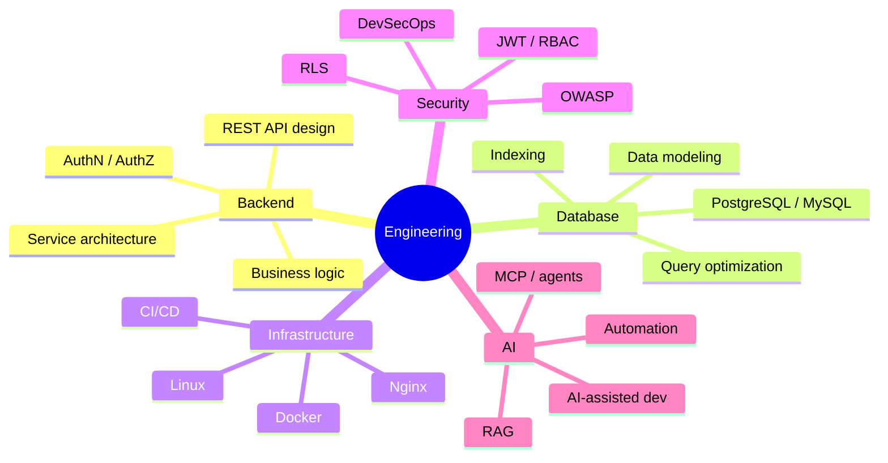

<div align="center">



<a href="https://github.com/yesterdaygrace">
  
</a>

<br/>


<br/><br/>

**[About](#-about) · [Projects](#-featured-projects) · [Experience](#-professional-experience) · [Stack](#-tech-stack) · [Stats](#-github-analytics) · [Roadmap](#-engineering-roadmap) · [Connect](#-connect)**

</div>

---

## 👨‍💻 About

I'm a **Full Stack Web Developer** focused on **backend engineering, databases, enterprise systems, and practical automation**. Graduate in Informatics Engineering from **Universitas Kristen Satya Wacana**, with **1 year 5 months** of hands-on experience shipping and maintaining real software.

My strongest experience is **DAPENSE**, a pension fund information system, where I covered requirements, database design, backend, testing, deployment, and post-launch maintenance.

Now: moving from a Laravel foundation into **TypeScript and Go**, and going deeper into **Docker, CI/CD, Linux, DevSecOps, and AI-assisted development**.

```ts
const kevin = {
  role:      "Full Stack Web Developer",
  strongIn:  ["Laravel", "PostgreSQL", "REST APIs", "RBAC"],
  leveling:  ["Go", "TypeScript", "Docker", "CI/CD", "DevSecOps"],
  shipped:   ["Threads saved-posts scanner", "Inventory ledger", "Pension fund accounting"],
  exploring: ["RAG", "MCP", "Agentic workflows", "Distributed systems"],
  principle: "Architecture, database, security and deployment must actually matter.",
} as const;
```

<details>
<summary><b>⚡ Quick facts (click to expand)</b></summary>

<br/>

| | |
|---|---|
| 🎓 **Education** | Informatics Engineering — Universitas Kristen Satya Wacana |
| 💼 **Experience** | 1 yr 5 mo (Jul 2024 → Dec 2025) |
| 🐧 **Daily driver** | Fedora / Linux |
| 🧭 **Focus** | Backend · Database · Security · Infra · AI automation |
| 🎯 **Goal** | Understand a system end-to-end: database → backend → API → frontend → infra → security → automation |

</details>

---

## 🚀 Featured Projects

<table>
<tr>
<td width="50%" valign="top">

### 🧵 SijiSiyu
**Local-first Threads library + saved-posts scanner**

Nuxt + Nitro backend with Meta Threads OAuth, an encrypted token vault, live SSE sync, and a Chromium extension that scans and syncs your saved posts.


<a href="https://github.com/yesterdaygrace/SijiSiyu"><b>View Repository →</b></a>

</td>
<td width="50%" valign="top">

### 🔎 DevScout
**GitHub developer sourcing & comparison**

Search, shortlist, compare and score GitHub developers. Collections, markdown notes, saved searches, and a 0–100 candidate score.


<a href="https://github.com/yesterdaygrace/DevScout"><b>Repository →</b></a> · <a href="https://dev-scout-lac.vercel.app"><b>Live demo ↗</b></a>

</td>
</tr>
<tr>
<td width="50%" valign="top">

### 📦 Inventra
**Multi-warehouse inventory system**

Go + PostgreSQL backend with a React dashboard. Append-only ledger, reservations, cycle counts, RBAC, audit trail and idempotent stock operations.


<a href="https://github.com/yesterdaygrace/Inventra"><b>View Repository →</b></a>

</td>
<td width="50%" valign="top">

### 🏦 DAPENSE
**Pension fund accounting system**

Double-entry journals, 3NF chart of accounts, period close and role-gated reporting for a real pension fund. Documented with an ERD and a SQL showcase.


<a href="https://github.com/yesterdaygrace/DAPENSE"><b>View Repository →</b></a>

</td>
</tr>
</table>

<details>
<summary><b>🧵 SijiSiyu — scanner, security & architecture</b></summary>

<br/>



**The scan (extension)**
- Real-time sync: bookmarking a post on `threads.net` streams it to the local app and shows an in-page toast
- Auto-scan on the `/saved` feed using a `MutationObserver` as new bookmarks load
- Manual bulk scanner with auto-scroll across your full history, plus JSON backup
- Offline queue in `chrome.storage.local` that flushes when the backend comes back
- In-app alternatives: JSON import and a 1-click bookmarklet

**Why a scanner:** Meta's official Threads API does not expose the Saved collection or an Unsave endpoint, so the project does not invent either. The extension reads the logged-in website instead.

**Security & engineering**
- AES-256-GCM encryption for access tokens at rest, never returned to the frontend
- HttpOnly / SameSite session cookies; only a SHA-256 hash of each session token is stored
- OAuth state validation against login CSRF; scanner imports restricted to `threads.net` / `threads.com` permalinks
- SQLite WAL mode, atomic transactions, singleton guard enforced by `CHECK (singleton = 1)`
- Live sync via Server-Sent Events; tracking-free "Copy link" that strips `?s=` / `?utm_` params
- Dynamic collections with auto-tagging keywords; `start.sh` / `saved` CLI with daemon and systemd service modes

> Built for local personal use; the README says not to expose it publicly as-is.

</details>

<details>
<summary><b>🔎 DevScout — highlights & architecture</b></summary>

<br/>



- 🔐 GitHub PAT stays server-side behind a Hono proxy; Zod-validated routes; OpenAPI at `/docs`
- ⚡ Two-tier cache (client 30 min, server memory) plus a request queue (`MAX_CONCURRENT=10`) to protect API limits
- 🧮 6-factor candidate score → 0–100 with ranks from *Emerging* to *Exceptional*
- 📊 Skill breakdown: language bytes aggregated across up to 20 non-fork repos with `Promise.allSettled`
- 🗄️ Per-user isolation with Row Level Security on all 7 tables
- 🧪 Vitest unit tests + Playwright E2E · zero-config demo mode

</details>

<details>
<summary><b>📦 Inventra — highlights & architecture</b></summary>

<br/>



- 🏬 Multi-warehouse stock with `UNIQUE(product_id, warehouse_id)` · 17 tables · 13 migrations
- 📒 Append-only ledger; balances are derived on read with window functions
- ⚛️ Atomic transactions with `SELECT … FOR UPDATE` row locks on hot paths
- 🔁 Idempotency keys: same key + same body replays, different body returns `409`
- 🔐 JWT with rotating refresh tokens and reuse detection · bcrypt · DB-backed RBAC
- 🧾 Failure-safe audit trail that never blocks business writes
- ✅ `testify` + `uber mock`, CI coverage gate ≥ 80% per package · `govulncheck` in CI
- 📚 18 screenshots and 11 docs covering architecture, API, database, ER, security and testing

</details>

<details>
<summary><b>🏦 DAPENSE — highlights & architecture</b></summary>

<br/>



- 🗄️ 3NF schema: 8 core tables, FK cascades, domain uniques, 19 migrations
- 💰 `NUMERIC(15,2)` money columns with a `bccomp` balanced-journal guard
- 📅 Period lifecycle: open → closed (`is_rekap`) → trial-balance snapshot
- 🛡️ 4 roles (`rootsuperuser`, `admin`, `operator`, `bod`), 8 Policies and 4 Gates, enforced server-side
- 💾 AES-256 encrypted `mysqldump` / `pg_dump` backups with 30-day retention
- 🐳 Docker Compose for MySQL 8.4 (prod), PostgreSQL 16 (portable) and SQLite (fallback)
- 📚 Docs on ERD, SQL showcase (synthetic data, no PII), security, testing and deployment

</details>

### 🧰 More repositories

| Repo | What it is | Stack |
|---|---|---|
| [**CinemaSystem**](https://github.com/yesterdaygrace/CinemaSystem) | Backend engineer assessment: national-scale cinema ticketing with seat-hold design, 14-table PostgreSQL schema and a Go REST API. Schedule overlaps are blocked in the database with `btree_gist`. | `Go` `PostgreSQL` `JWT` `Swagger` `Postman` |
| [**Nodex**](https://github.com/yesterdaygrace/Nodex) | "crudin": small CRUD API with pagination, a consistent response envelope and a test suite that locks the API contract. | `Go` `Gin` `GORM` `Vue 3` |
| [**portfolio**](https://github.com/yesterdaygrace/portfolio) · [live ↗](https://yesterdaygrace.github.io/portfolio/) | Engineering portfolio with architecture case studies. CI runs audit, typecheck and build, then deploys to GitHub Pages. | `React 19` `TypeScript` `Vite` `GSAP` |

> **Note on CinemaSystem:** its README states that the Redis Redlock seat lock is a design proposal for the written test. The Go code does not implement it.

---

## 🏢 Professional Experience

### DAPENSE — Pension Fund Information System

**Full Stack Web Developer Intern** · Dana Pensiun Sekolah Kristen Salatiga · `Jul 2024 → Dec 2025`

Built and maintained a web-based pension fund information system that modernized legacy financial workflows.



<details>
<summary><b>🧩 Core modules</b></summary>

<br/>

`General Ledger` · `Journal Processing` · `Cash & Bank Transactions` · `Financial Reporting` · `Balance Reconciliation`

</details>

<details>
<summary><b>🛠️ What I worked on</b></summary>

<br/>

- Translated accounting business processes into application requirements
- Designed ERDs and normalized relational database structures
- Developed financial transaction workflows and RESTful APIs
- Implemented authentication, RBAC, validation, and structured workflows
- Improved database relationships and query performance
- Coordinated UAT with accounting stakeholders; shipped feedback and production fixes
- Managed deployment, post-deployment maintenance, and infrastructure troubleshooting
- Maintained backups and data-access controls
- Wrote functional and technical documentation

</details>


> **Selected project results:** approx. **30–40% improvement in operational efficiency** and **25–30% reduction in manual input errors**, based on project experience and the workflow/validation improvements implemented.

---

## 🧠 Engineering Focus

> I don't want my GitHub to become a museum of framework tutorials. I build systems where architecture, database, security, and deployment actually matter.



---

## 🛠️ Tech Stack

<div align="center">

**Languages & Frameworks**


**Data**


**Infra & DevOps**


</div>

<details>
<summary><b>🔎 Full breakdown</b></summary>

<br/>

| Layer | Tools |
|---|---|
| **Backend & APIs** | Laravel · Livewire · PHP · Go (Gin, GORM) · Nuxt/Nitro · Hono · Zod · REST · OpenAPI/Swagger · JWT · OAuth 2.0 · Server-Sent Events |
| **Frontend** | React 19 · Vue 3 · Nuxt · Pinia · TanStack Query · Tailwind CSS · Vite · TypeScript · Chart.js |
| **Browser & integrations** | Chromium extensions (content scripts, background worker, offline queue) · Meta Threads API · GitHub REST API · MutationObserver scanning |
| **Databases** | PostgreSQL · MySQL · SQLite (WAL) · Redis · Supabase · Database Design · Normalization · ERD · Indexing · Query Optimization |
| **Architecture** | Clean Architecture · Layered Architecture · RBAC |
| **Infrastructure** | Linux · Docker Compose · Nginx · GitHub Actions · Vercel · GitHub Pages · systemd |
| **Security** | AES-256-GCM token vault · HttpOnly/SameSite sessions · OAuth state (CSRF) · JWT rotation · bcrypt · RBAC · RLS · rate limiting · govulncheck · `pnpm audit` · OWASP |
| **Testing & Debugging** | testify · uber mock · Vitest · PHPUnit · Playwright · Postman · coverage gates · Laravel Debugbar · Chrome DevTools |
| **Documentation** | Per-repo `docs/` with architecture, API, database, ER, security, testing and deployment · Mermaid diagrams |
| **AI-assisted dev** | OpenCode · Cursor · ChatGPT · Codex · Claude |

</details>

---

## 📊 GitHub Analytics

<div align="center">

<picture>
  <source media="(prefers-color-scheme: dark)" srcset="https://github-readme-stats.vercel.app/api?username=yesterdaygrace&show_icons=true&hide_border=true&count_private=true&include_all_commits=true&theme=tokyonight&bg_color=0d1117&title_color=a78bfa&icon_color=6366f1" />
  
</picture>
<picture>
  <source media="(prefers-color-scheme: dark)" srcset="https://github-readme-stats.vercel.app/api/top-langs/?username=yesterdaygrace&layout=compact&hide_border=true&langs_count=8&theme=tokyonight&bg_color=0d1117&title_color=a78bfa" />
  
</picture>

<picture>
  <source media="(prefers-color-scheme: dark)" srcset="https://streak-stats.demolab.com?user=yesterdaygrace&hide_border=true&theme=tokyonight&background=0d1117&ring=a78bfa&fire=a855f7&currStreakLabel=a78bfa" />
  
</picture>

<picture>
  <source media="(prefers-color-scheme: dark)" srcset="https://github-readme-activity-graph.vercel.app/graph?username=yesterdaygrace&bg_color=0d1117&color=a78bfa&line=6366f1&point=ffffff&area=true&area_color=6366f1&hide_border=true" />
  
</picture>

</div>

---

## 🧪 Currently Learning

<table>
<tr>
<td width="25%" valign="top">

**☁️ Infrastructure**

<br/>
<br/>
<br/>
<br/>
<br/>


</td>
<td width="25%" valign="top">

**🔐 Security**

<br/>
<br/>
<br/>
<br/>


</td>
<td width="25%" valign="top">

**🤖 AI Engineering**

<br/>
<br/>
<br/>


</td>
<td width="25%" valign="top">

**⚙️ Systems**

<br/>
<br/>
<br/>


</td>
</tr>
</table>

---

## 🗺️ Engineering Roadmap


The goal isn't collecting technologies. It's understanding how a system behaves from **database → backend → API → frontend → infrastructure → security → automation**.

---

## 📫 Connect

<div align="center">

<a href="https://github.com/yesterdaygrace"></a>
<a href="https://www.linkedin.com/in/kevin-van-diesel-chansa/"></a>
<a href="https://yesterdaygrace.github.io/portfolio/"></a>

<br/><br/>


</div>
