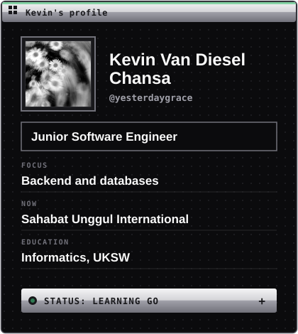
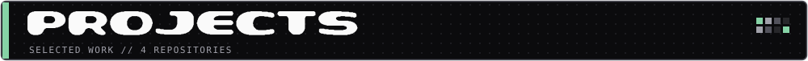
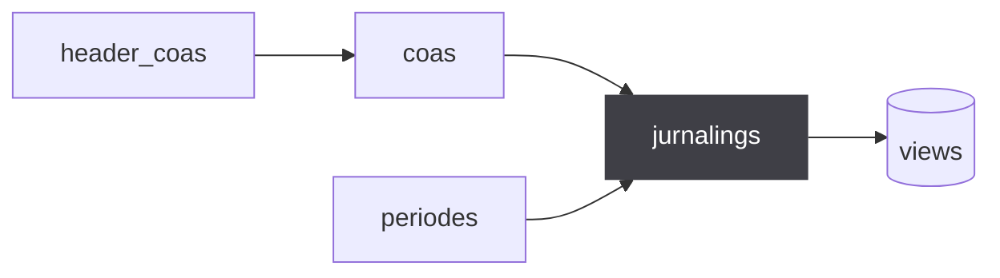
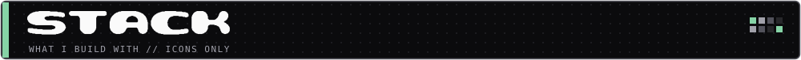
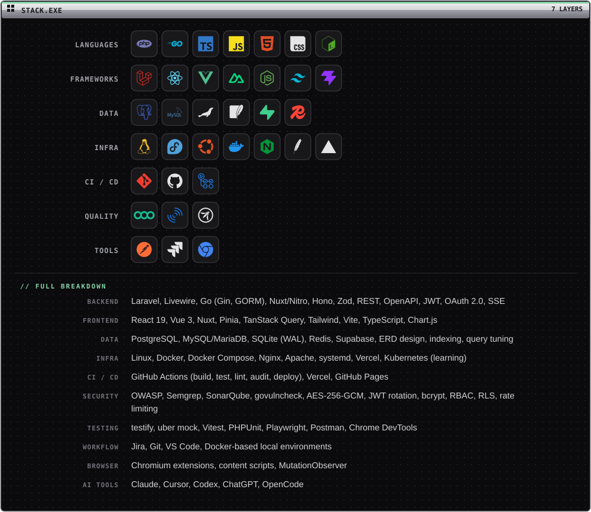
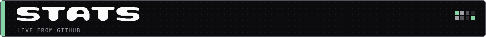
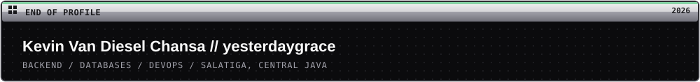

  <a href="https://www.linkedin.com/in/kevin-van-diesel-chansa/">LinkedIn</a> ·
  <a href="https://yesterdaygrace.github.io/portfolio/">Portfolio</a> ·
  <a href="https://dev-scout-lac.vercel.app">DevScout demo</a> ·
  <a href="https://github.com/yesterdaygrace?tab=repositories">All repositories</a>

<b><a href="#projects">Projects</a> · <a href="#experience">Experience</a> · <a href="#stack">Stack</a> · <a href="#stats">Stats</a> · <a href="#learning">Learning</a></b>

<table>
  <tr>
    <td width="40%" valign="top">
      
    </td>
    <td width="60%" valign="top">
      <h3>Hey, I'm Kevin.</h3>
      
Junior software engineer working across backend, frontend, databases and DevOps. Informatics Engineering graduate (UKSW) with 2+ years shipping and maintaining business software.

      
At <b>PT Sahabat Unggul International</b> I maintain a factory's web and desktop apps and run its MySQL/MariaDB, Docker and Apache stack.

      
Outside work I build Go and TypeScript projects to move beyond my Laravel base.

      <table>
        <tr><th>If you are</th><th>Start here</th></tr>
        <tr><td>Hiring</td><td><a href="#experience">Experience</a> · <a href="https://www.linkedin.com/in/kevin-van-diesel-chansa/">LinkedIn</a></td></tr>
        <tr><td>Reviewing code</td><td><a href="https://github.com/yesterdaygrace/SijiSiyu">SijiSiyu</a> · <a href="https://github.com/yesterdaygrace/Inventra">Inventra</a> (each has a <code>docs/</code> folder)</td></tr>
        <tr><td>Short on time</td><td><a href="https://dev-scout-lac.vercel.app">DevScout demo</a> · <a href="https://yesterdaygrace.github.io/portfolio/">Portfolio</a></td></tr>
      </table>
    </td>
  </tr>
</table>

  
  
  
  

<b>🧵 SijiSiyu: local-first Threads library with a saved-posts scanner</b>

 

`Nuxt` `Vue 3` `TypeScript` `SQLite (WAL)` `Tailwind` `Chromium extension` · [repo](https://github.com/yesterdaygrace/SijiSiyu) · 

- Saving a post on `threads.net` streams it to the local app and shows a toast
- `MutationObserver` captures new bookmarks as the `/saved` feed scrolls; a bulk scan walks the full history
- Offline queue in `chrome.storage.local` flushes when the backend returns
- Why an extension: Meta's Threads API has no Saved or Unsave endpoint, so the project reads the logged-in site instead
- Tokens are AES-256-GCM encrypted at rest; sessions store only a SHA-256 hash; OAuth state guards against login CSRF

<b>🔎 DevScout: search, compare and score GitHub developers</b>

 

`Vue 3` `TypeScript` `Hono` `Supabase` `Tailwind` `Vite` `Vercel` · [repo](https://github.com/yesterdaygrace/DevScout) · [live demo](https://dev-scout-lac.vercel.app) · 

- The GitHub token stays server-side behind a Zod-validated Hono proxy with rate limiting and a request queue
- 6-factor candidate score (0 to 100) and a language breakdown over up to 20 non-fork repos
- Row Level Security on all 7 tables; Vitest unit tests and Playwright E2E

<b>📦 Inventra: multi-warehouse inventory that protects stock</b>

 

`Go` `PostgreSQL 17` `React 19` `TypeScript` `Docker` `GitHub Actions` · [repo](https://github.com/yesterdaygrace/Inventra) · 

- Append-only ledger: corrections add a row, balances are derived on read
- `SELECT ... FOR UPDATE` row locks inside transactions; idempotency keys return `409` on a changed body
- JWT with refresh rotation and reuse detection, DB-backed RBAC, failure-safe audit trail
- 17 tables, 13 migrations, CI coverage gate at 80% per package

<b>🏦 DAPENSE: pension fund accounting</b>

 

`Laravel` `PHP 8.3` `MySQL 8.4` `Redis` `Docker` `Nginx` · [repo](https://github.com/yesterdaygrace/DAPENSE) · 

- 3NF schema, 8 core tables, `NUMERIC(15,2)` money columns and a balanced-journal guard
- Open, closed, then trial-balance snapshot per period
- 4 roles enforced by Policies and Gates; encrypted backups with 30-day retention

**More repositories**

| Repo | What it is | Stack |
|---|---|---|
| 🎬 [CinemaSystem](https://github.com/yesterdaygrace/CinemaSystem) | Cinema ticketing backend assessment. PostgreSQL `btree_gist` blocks overlapping schedules. Its Redis seat lock is a design proposal only. |  |
| 📝 [Nodex](https://github.com/yesterdaygrace/Nodex) | CRUD API with pagination and a test suite that locks the API contract |  |
| 🌐 [portfolio](https://github.com/yesterdaygrace/portfolio) | Case-study portfolio; CI runs audit, typecheck and build, then deploys to GitHub Pages |  |

| When | Role |
|---|---|
| `Oct 2026 → now` | 🏭 **Junior Software Engineer**, PT Sahabat Unggul International (contract) |
| `Aug 2024 → Dec 2025` | 🏦 **Full Stack Web Developer (intern)**, Dana Pensiun Sekolah Kristen Salatiga |
| `Aug → Dec 2024` | 🎓 **Teaching Assistant**, Web Developer course, UKSW |

<b>🏭 Sahabat Unggul: factory systems</b>

 

- Fix bugs and add features to SUI APPS V2.0 (web and desktop) from factory operations requirements
- Run MySQL/MariaDB: backups, query tuning, monitoring
- Support Linux servers: Docker containers, Apache and MySQL services, log monitoring
- Gather requirements with HR, Production, Finance and Warehouse; document code changes and procedures

<b>🏦 Dana Pensiun: legacy VDOS to Laravel</b>

 

- Migrated a legacy VDOS-based financial system to Laravel
- Built General Ledger, Journal Processing, Cash & Bank, Financial Reporting and Balance Reconciliation modules
- Turned accounting workflows into features with finance stakeholders, in 1 to 2 week sprints
- Tested at unit, integration and UAT level before releases
- Self-reported results: about 30 to 40% better operational efficiency and 25 to 30% fewer manual input errors

<b>🎓 Teaching assistant</b>

 

4 classes, 100+ students, 400+ assignments reviewed. Taught HTML, CSS, PHP and MySQL, and standardized grading across classes.

<b>🔎 Full breakdown</b>

 

| Layer | Tools |
|---|---|
| ⚙️ **Backend** | Laravel, Livewire, Go (Gin, GORM), Nuxt/Nitro, Hono, Zod, REST, OpenAPI, JWT, OAuth 2.0, SSE |
| 🎨 **Frontend** | React 19, Vue 3, Nuxt, Pinia, TanStack Query, Tailwind, Vite, TypeScript, Chart.js |
| 🗄️ **Data** | PostgreSQL, MySQL/MariaDB, SQLite (WAL), Redis, Supabase, ERD design, indexing, query tuning |
| 🐳 **Infra** | Linux, Docker, Docker Compose, Nginx, Apache, systemd, Vercel, Kubernetes (learning) |
| 🔁 **CI/CD** | GitHub Actions (build, test, lint, audit, deploy), Vercel, GitHub Pages |
| 🛡️ **Security & quality** | OWASP, Semgrep, SonarQube, govulncheck, AES-256-GCM, JWT rotation, bcrypt, RBAC, RLS, rate limiting |
| 🧪 **Testing & debugging** | testify, uber mock, Vitest, PHPUnit, Playwright, Postman, Chrome DevTools |
| 🧰 **Workflow** | Jira, Git, VS Code, Docker-based local environments |
| 🌐 **Browser** | Chromium extensions, content scripts, MutationObserver |
| 🤖 **AI tools** | Claude, Cursor, Codex, ChatGPT, OpenCode |

<picture>
  <source media="(prefers-color-scheme: dark)" srcset="https://github-readme-stats.vercel.app/api?username=yesterdaygrace&show_icons=true&hide_border=true&count_private=true&include_all_commits=true&theme=dark&bg_color=0d1117&title_color=ffffff&icon_color=86d3a6" />
  
</picture>
<picture>
  <source media="(prefers-color-scheme: dark)" srcset="https://github-readme-stats.vercel.app/api/top-langs/?username=yesterdaygrace&layout=compact&hide_border=true&langs_count=8&theme=dark&bg_color=0d1117&title_color=ffffff" />
  
</picture>

<picture>
  <source media="(prefers-color-scheme: dark)" srcset="https://streak-stats.demolab.com?user=yesterdaygrace&hide_border=true&theme=dark&background=0d1117&ring=86d3a6&fire=86d3a6&currStreakLabel=ffffff" />
  
</picture>

<b>📈 Contribution graph</b>

 

<picture>
  <source media="(prefers-color-scheme: dark)" srcset="https://github-readme-activity-graph.vercel.app/graph?username=yesterdaygrace&bg_color=0d1117&color=ffffff&line=86d3a6&point=ffffff&area=true&area_color=3f3f46&hide_border=true" />
  
</picture>

   
   
   
   
  

