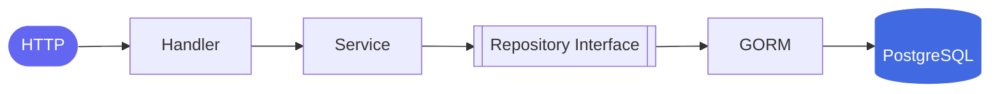
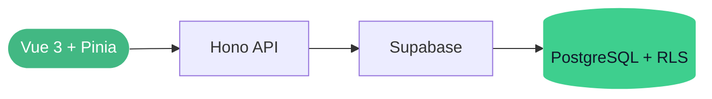
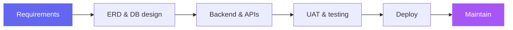
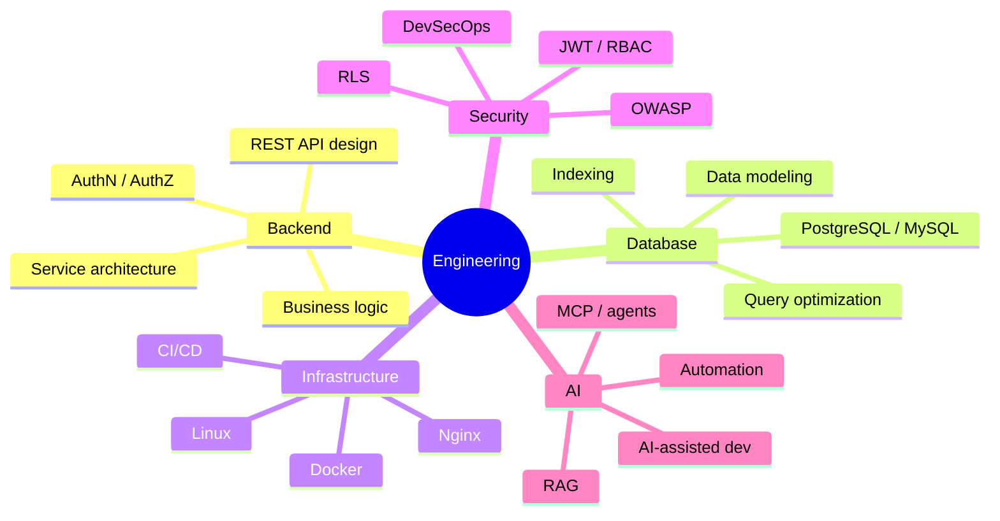
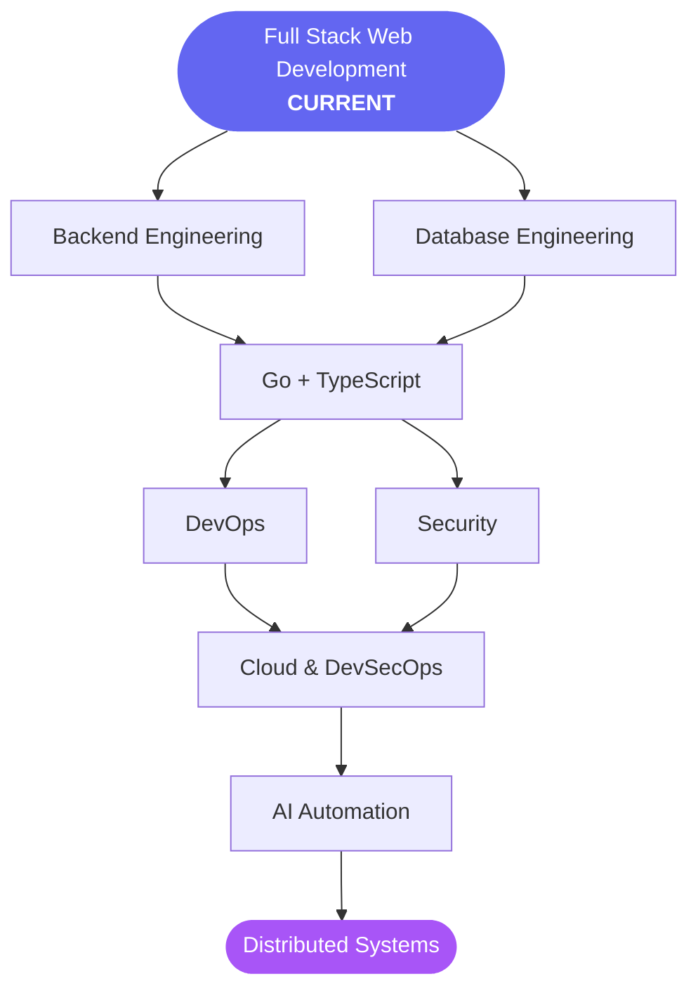

<div align="center">


<a href="https://github.com/yesterdaygrace">
  
</a>

<br/>


<br/><br/>

**[About](#-about) · [Projects](#-featured-projects) · [Experience](#-professional-experience) · [Stack](#-tech-stack) · [Stats](#-github-analytics) · [Roadmap](#-engineering-roadmap) · [Connect](#-connect)**

</div>

---

## 👨‍💻 About

I'm a **Full Stack Web Developer** focused on **backend engineering, databases, enterprise systems, and practical automation**. Graduate in Informatics Engineering from **Universitas Kristen Satya Wacana**, with **1 year 5 months** of hands-on experience shipping and maintaining real software.

My strongest experience is **DAPENSE**, a pension fund information system, where I covered requirements, database design, backend, testing, deployment, and post-launch maintenance.

Now: moving from a Laravel foundation into **TypeScript and Go**, and going deeper into **Docker, CI/CD, Linux, DevSecOps, and AI-assisted development**.

```ts
const kevin = {
  role:      "Full Stack Web Developer",
  strongIn:  ["Laravel", "PostgreSQL", "REST APIs", "RBAC"],
  leveling:  ["Go", "TypeScript", "Docker", "CI/CD", "DevSecOps"],
  exploring: ["RAG", "MCP", "Agentic workflows", "Distributed systems"],
  principle: "Architecture, database, security and deployment must actually matter.",
} as const;
```

<details>
<summary><b>⚡ Quick facts (click to expand)</b></summary>

<br/>

| | |
|---|---|
| 🎓 **Education** | Informatics Engineering — Universitas Kristen Satya Wacana |
| 💼 **Experience** | 1 yr 5 mo (Jul 2024 → Dec 2025) |
| 🐧 **Daily driver** | Fedora / Linux |
| 🧭 **Focus** | Backend · Database · Security · Infra · AI automation |
| 🎯 **Goal** | Understand a system end-to-end: database → backend → API → frontend → infra → security → automation |

</details>

---

## 🚀 Featured Projects

<table>
<tr>
<td width="50%" valign="top">

### 📦 Inventra
**Inventory Management Backend**

Production-style inventory system built to practice serious backend patterns.


<a href="https://github.com/yesterdaygrace"><b>View Repository →</b></a>

</td>
<td width="50%" valign="top">

### 🔎 DevScout
**Developer & Opportunity Platform**

Full-stack app combining developer profiles, skills, projects, jobs, applications, and GitHub integration.


<a href="https://github.com/yesterdaygrace"><b>View Repository →</b></a>

</td>
</tr>
</table>

<details>
<summary><b>📦 Inventra — highlights & architecture</b></summary>

<br/>



- 🏬 Multi-warehouse inventory
- 📒 Stock ledger & reservations
- 🔢 Cycle counts & adjustments
- ⚛️ Atomic database transactions + row-level locking
- 🔁 Idempotent operations
- 🔐 JWT auth · RBAC · refresh-token rotation
- 🧾 Audit logging · CSV exports
- 📘 OpenAPI documentation
- 🐳 Docker & CI · ✅ automated testing

</details>

<details>
<summary><b>🔎 DevScout — highlights & architecture</b></summary>

<br/>



- 👤 Developer profiles, skills & project management
- 📌 Job and application tracking
- 🐙 GitHub API integration through an API proxy layer
- 🔐 Authentication · PostgreSQL relational design · Row Level Security
- ⚡ API caching · rate limiting
- 📘 OpenAPI · ☁️ Supabase deployment

</details>

---

## 🏢 Professional Experience

### DAPENSE — Pension Fund Information System

**Full Stack Web Developer Intern** · Dana Pensiun Sekolah Kristen Salatiga · `Jul 2024 → Dec 2025`

Built and maintained a web-based pension fund information system that modernized legacy financial workflows.



<details>
<summary><b>🧩 Core modules</b></summary>

<br/>

`General Ledger` · `Journal Processing` · `Cash & Bank Transactions` · `Financial Reporting` · `Balance Reconciliation`

</details>

<details>
<summary><b>🛠️ What I worked on</b></summary>

<br/>

- Translated accounting business processes into application requirements
- Designed ERDs and normalized relational database structures
- Developed financial transaction workflows and RESTful APIs
- Implemented authentication, RBAC, validation, and structured workflows
- Improved database relationships and query performance
- Coordinated UAT with accounting stakeholders; shipped feedback and production fixes
- Managed deployment, post-deployment maintenance, and infrastructure troubleshooting
- Maintained backups and data-access controls
- Wrote functional and technical documentation

</details>


> **Selected project results:** approx. **30–40% improvement in operational efficiency** and **25–30% reduction in manual input errors**, based on project experience and the workflow/validation improvements implemented.

---

## 🧠 Engineering Focus

> I don't want my GitHub to become a museum of framework tutorials. I build systems where architecture, database, security, and deployment actually matter.



---

## 🛠️ Tech Stack

<div align="center">

**Languages & Frameworks**


**Data**


**Infra & DevOps**


</div>

<details>
<summary><b>🔎 Full breakdown</b></summary>

<br/>

| Layer | Tools |
|---|---|
| **Backend & APIs** | Laravel · PHP · Go (Gin) · Hono · REST · OpenAPI · JWT |
| **Frontend** | React · Vue 3 · Pinia · Tailwind CSS · TypeScript |
| **Databases** | PostgreSQL · MySQL · Supabase · Database Design · Normalization · ERD · Indexing · Query Optimization |
| **Architecture** | Clean Architecture · Layered Architecture · RBAC |
| **Infrastructure** | Linux · Docker · Nginx · CI/CD |
| **Security** | OWASP · JWT · RBAC · RLS · SAST · Trivy |
| **Testing & Debugging** | PHPUnit · Playwright · Postman · Laravel Debugbar · Chrome DevTools |
| **AI-assisted dev** | OpenCode · Cursor · ChatGPT · Codex · Claude |

</details>

---

## 📊 GitHub Analytics

<div align="center">

<picture>
  <source media="(prefers-color-scheme: dark)" srcset="https://github-readme-stats.vercel.app/api?username=yesterdaygrace&show_icons=true&hide_border=true&count_private=true&include_all_commits=true&theme=tokyonight&bg_color=0d1117&title_color=a78bfa&icon_color=6366f1" />
  
</picture>
<picture>
  <source media="(prefers-color-scheme: dark)" srcset="https://github-readme-stats.vercel.app/api/top-langs/?username=yesterdaygrace&layout=compact&hide_border=true&langs_count=8&theme=tokyonight&bg_color=0d1117&title_color=a78bfa" />
  
</picture>

<picture>
  <source media="(prefers-color-scheme: dark)" srcset="https://streak-stats.demolab.com?user=yesterdaygrace&hide_border=true&theme=tokyonight&background=0d1117&ring=a78bfa&fire=a855f7&currStreakLabel=a78bfa" />
  
</picture>

<picture>
  <source media="(prefers-color-scheme: dark)" srcset="https://github-readme-activity-graph.vercel.app/graph?username=yesterdaygrace&bg_color=0d1117&color=a78bfa&line=6366f1&point=ffffff&area=true&area_color=6366f1&hide_border=true" />
  
</picture>

</div>

---

## 🧪 Currently Learning

<table>
<tr>
<td width="25%" valign="top">

**☁️ Infrastructure**

<br/>
<br/>
<br/>
<br/>
<br/>


</td>
<td width="25%" valign="top">

**🔐 Security**

<br/>
<br/>
<br/>
<br/>


</td>
<td width="25%" valign="top">

**🤖 AI Engineering**

<br/>
<br/>
<br/>


</td>
<td width="25%" valign="top">

**⚙️ Systems**

<br/>
<br/>
<br/>


</td>
</tr>
</table>

---

## 🗺️ Engineering Roadmap



The goal isn't collecting technologies. It's understanding how a system behaves from **database → backend → API → frontend → infrastructure → security → automation**.

---

## 📫 Connect

<div align="center">

<a href="https://github.com/yesterdaygrace"></a>

<br/><br/>


</div>
